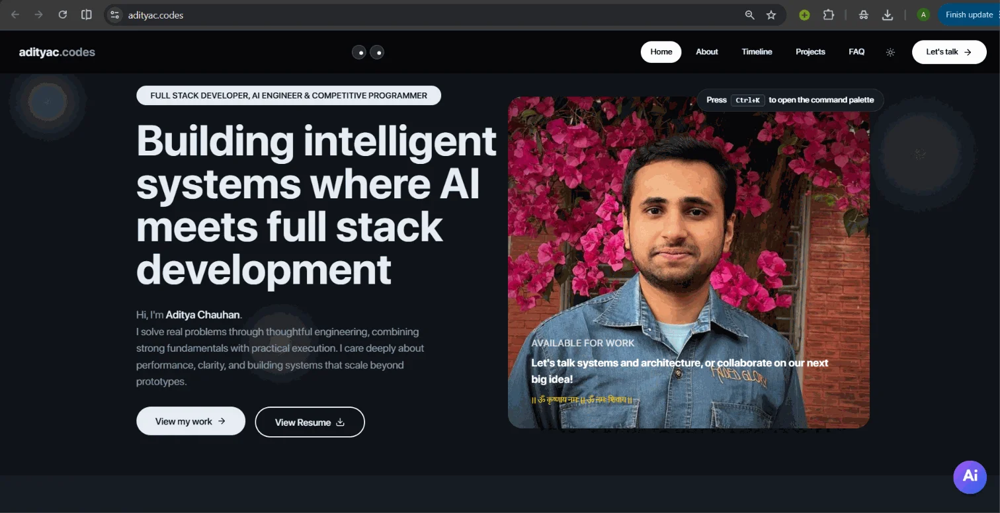
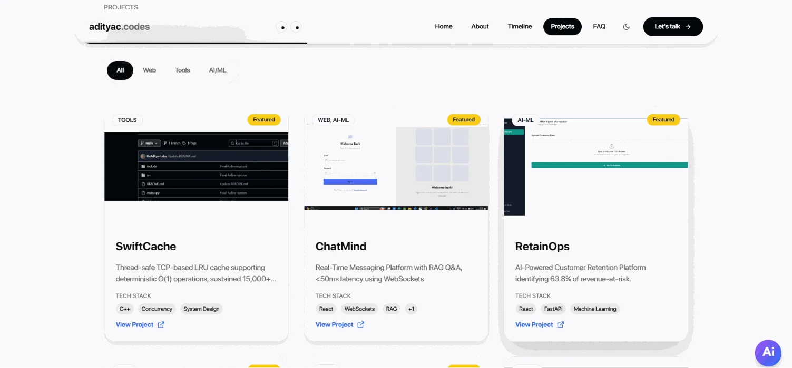
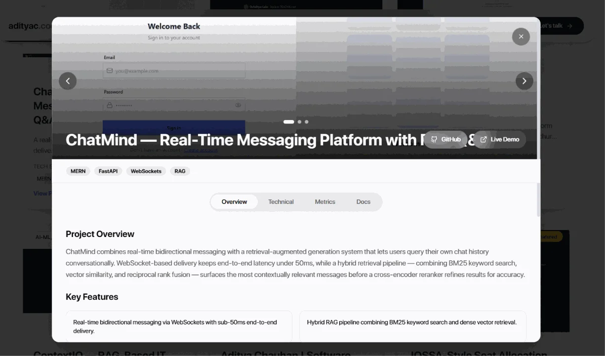
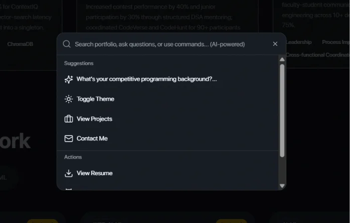
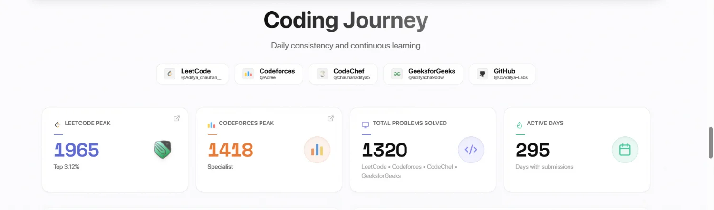
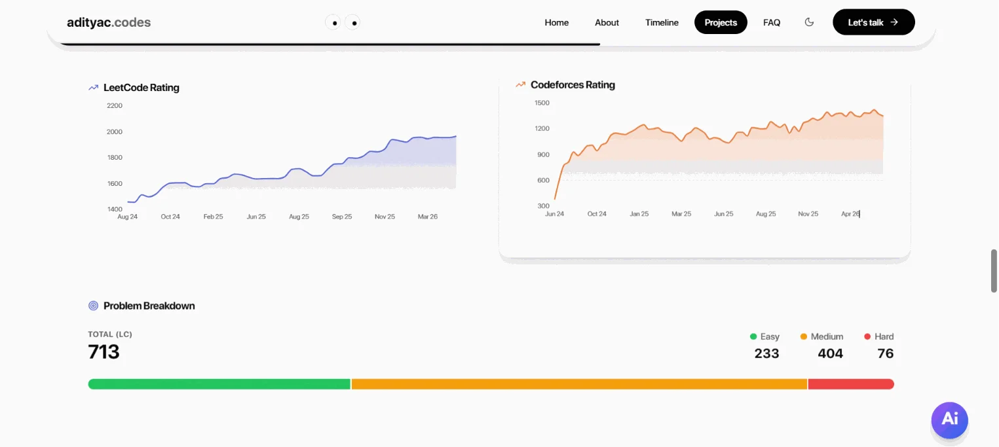
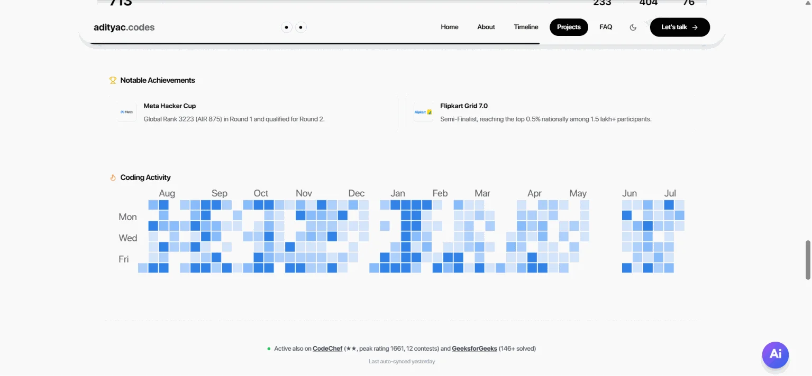
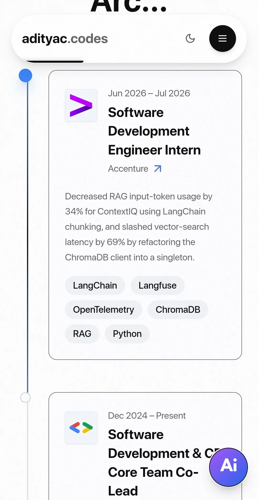

<div align="center">

# Aditya Chauhan | Portfolio

<a href="https://adityac.codes">

</a>

### **Engineered like a product: AI-powered navigation meets performance-first design.**

[](https://www.typescriptlang.org/)
[](https://react.dev/)
[](https://vitejs.dev/)
[](https://tailwindcss.com/)
[](https://vercel.com/)

<br />

[🚀 Quick Start](#-quick-start) • [✨ Highlights](#-feature-highlights) • [🖼️ Screenshots](#%EF%B8%8F-screenshots) • [🛠️ Tech Stack](#%EF%B8%8F-tech-stack) • [📬 Contact](#-contact)

<br />

</div>

## 🎯 Overview

This is a modern, product-grade developer portfolio built with React + Vite + TypeScript, designed to showcase projects, experience, and live coding stats with a premium UX.

It’s optimized for keyboard-first navigation, smooth scroll interactions, and fast perceived performance (preloading, lightweight animations, and a clean component architecture).

---

## ✨ Core Features

<table>
<tr>
<td width="50%">

### 🤖 Gemini AI Command Palette
- Embedded AI search trained on Aditya's resume and background
- Keyboard-first UX (**Ctrl+K**) for instant navigation
- Graceful degradation: Hardcoded fallback logic if API limits are reached
- Fluid natural language Q&A about projects and experience

</td>
<td width="50%">

### 📊 Competitive Coding Dashboard
- Live visualization of CP statistics and milestones
- Deep links to Codeforces (Specialist), LeetCode (Knight), and CodeChef (3-star)
- Dedicated tracking of 1,200+ DSA problems solved
- Clean, accessible data charts and progress widgets

</td>
</tr>
<tr>
<td width="50%">

### 🧩 Deep Project Modals
- Rich galleries and image carousels for project screenshots
- Detailed technical breakdowns (Challenges, Solutions, Architecture)
- Deep dives into specific metrics (e.g., QPS, Latency, Accuracy)
- Direct links to GitHub repositories and live deployments

</td>
<td width="50%">

### ⚡ Performance-First Architecture
- Near-instant loads with Vite and strategic image preloading
- Scroll-triggered reveals via IntersectionObserver
- Premium Glassmorphism UI built on Radix + shadcn/ui
- Seamless Dark/Light system-aware theme switching

</td>
</tr>
</table>

---

## 🖼️ Screenshots

<table>
   <tr>
      <td align="center" width="50%">
         
         <br />
         <sub><b>Hero</b> — Clean introduction and primary CTA</sub>
      </td>
      <td align="center" width="50%">
         
         <br />
         <sub><b>Projects</b> — Filterable showcase of system and AI builds</sub>
      </td>
   </tr>
   <tr>
      <td align="center" width="50%">
         
         <br />
         <sub><b>Project Modal</b> — Technical deep-dives and metrics</sub>
      </td>
      <td align="center" width="50%">
         
         <br />
         <sub><b>Command Palette</b> — Talk to the Gemini assistant with Ctrl+K</sub>
      </td>
   </tr>
   <tr>
      <td align="center" width="50%">
         
         <br />
         <sub><b>Coding Dashboard</b> — Real-time CP stats visualization</sub>
      </td>
      <td align="center" width="50%">
         
         <br />
         <sub><b>Algorithmic Milestones</b> — Dynamic platform aggregation</sub>
      </td>
   </tr>
   <tr>
      <td align="center" width="50%">
         
         <br />
         <sub><b>Coding Activity</b> — Granular DSA tracking</sub>
      </td>
      <td align="center" width="50%">
         
         <br />
         <sub><b>Mobile Experience</b> — Fully responsive navigation</sub>
      </td>
   </tr>
</table>

---

## 🚀 Quick Start

### 1. Clone & Install

```bash
git clone https://github.com/0xAditya-Labs/My_Portfolio.git
cd My_Portfolio
npm install
```

### 2. Configure Environment Variables

Create a `.env.local` file in the project root and configure your coding profiles:

```env
VITE_LEETCODE_USERNAME=your_leetcode_username
VITE_GFG_USERNAME=your_gfg_username
VITE_CODECHEF_USERNAME=your_codechef_username
VITE_CODEFORCES_USERNAME=your_codeforces_username
VITE_GITHUB_USERNAME=your_github_username
```

These variables configure the coding profiles displayed on the portfolio.

To enable the Gemini-powered AI Command Palette, configure `GEMINI_API_KEYS` as a server-side environment variable. For local development, add it to `.env.local` only if your server-side implementation loads that file:

```env
GEMINI_API_KEYS=your_key_one,your_key_two
```

Multiple keys can be provided as a comma-separated list if supported by the application's key-selection and fallback logic.

**Security:** Never expose Gemini API keys through `VITE_`-prefixed variables. Keep credentials out of client-side bundles and version control.

### 3. Start the Development Server

```bash
npm run dev
```

Open [http://localhost:8080](http://localhost:8080) in your browser.

### 4. Verify API Keys

If your repository includes `testing.js`, validate your configured Gemini keys with:

```bash
node testing.js
```

### 5. Build for Production

```bash
npm run build
npm run preview
```

### 6. Deploy to Vercel

Import the repository into Vercel and configure the required environment variables under **Project → Settings → Environment Variables**.

| Variable | Scope |
|---|---|
| `VITE_LEETCODE_USERNAME` | Public |
| `VITE_GFG_USERNAME` | Public |
| `VITE_CODECHEF_USERNAME` | Public |
| `VITE_CODEFORCES_USERNAME` | Public |
| `VITE_GITHUB_USERNAME` | Public |
| `GEMINI_API_KEYS` | Server-side only |

Apply the variables to the appropriate Production, Preview, and Development environments.

Ensure your deployment configuration preserves `/api/*` endpoints while routing frontend navigation to `index.html`, if your application uses Vercel serverless functions.


---

## 🛠️ Tech Stack

**Frontend Architecture**
- React 18, TypeScript, Vite
- Tailwind CSS

**UI / UX**
- shadcn/ui + Radix UI primitives
- framer-motion (Animations)
- lucide-react (Icons)
- next-themes (System-aware Dark Mode)

**Interactive 3D & Canvas Visualizations**
- WebGL 2.0 & Custom GLSL Shaders
- Gabriel Graph & Halo Spray (Aurora Drift components adapted from [OriginKit](https://originkit.com)
  - Custom Viewport Culling (`useIntersectionObserver`) for 0% background CPU usage
  - Hardware-adaptive dynamic DPR capping and O(n^2) mathematical optimization

**Data & AI**
- Google Gemini API (`generativelanguage.googleapis.com/v1beta`)
- Custom Fallback Search Algorithm (Graceful Degradation)

**Deployment & Analytics**
- Vercel (Hosting)
- Vercel Analytics + Speed Insights

---

## 🎨 Customization

The portfolio is organized to make personal updates straightforward.

- **Projects:** Edit `src/data/projects.ts` to update project information and metadata.
- **AI Assistant:** Update `src/lib/aiSearch.ts` to modify the assistant's knowledge base and fallback responses.
- **Branding & Themes:** Customize `src/index.css` to adjust CSS variables, colors, and theme styles.
- **Public Assets:** Replace images, icons, project screenshots, and preloader graphics in `public/`.

---


## 📬 Contact

**Aditya Chauhan**
- **Live Portfolio:** [adityac.codes](https://adityac.codes)
- **LinkedIn:** [aditya-chauhan-nitj](https://www.linkedin.com/in/aditya-chauhan-nitj/)
- **GitHub:** [@0xAditya-Labs](https://github.com/0xAditya-Labs)

- **Email:** aditya.chauhan.nitj.ac@gmail.com
- **X(formly Twitter):** [@AdityaNitj1204](https://x.com/AdityaNitj1204)

- **LeetCode:** [Aditya_chauhan__](https://leetcode.com/u/Aditya_chauhan__/)
- **Codeforces:** [Adree](https://codeforces.com/profile/Adree)


<br/>
<div align="center">

**⭐ If you enjoyed exploring this architecture or found it inspiring, consider dropping a star on the repo!**

</div>